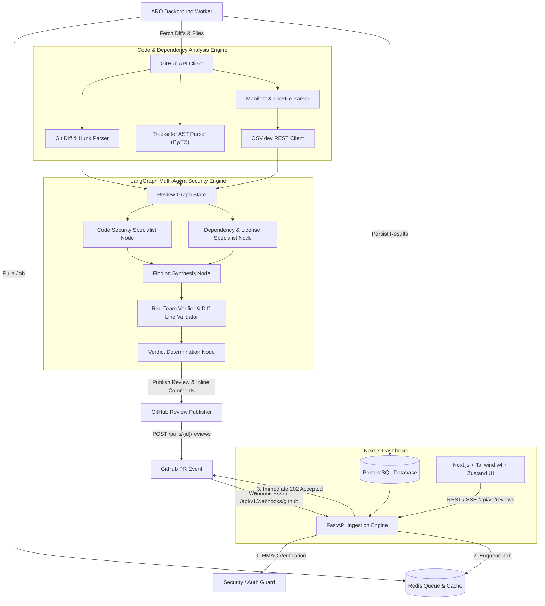

# PR-Sentinel

> **Autonomous AI-Powered GitHub Pull Request Security Reviewer**

PR-Sentinel is an autonomous, context-aware security code reviewer that intercepts GitHub pull requests, performs AST-based code analysis and dependency vulnerability/license auditing, orchestrates multi-agent security evaluation using **LangGraph**, verifies findings against false positives, and publishes actionable inline review comments and verdicts back to GitHub. It features a modern **Next.js** dashboard with live Server-Sent Events (SSE) updates and repository policy controls.

---

## Key Capabilities

- **Sub-Second Webhook Ingestion**: Verifies GitHub HMAC-SHA256 signatures in constant time and offloads review jobs to an asynchronous ARQ/Redis queue in <500ms.
- **AST-Aware Code Context**: Leverages **Tree-sitter** (Python & TypeScript/JavaScript) to parse enclosing functions, classes, decorators, and imports surrounding modified diff hunks.
- **OSV.dev CVE & License Auditing**: Analyzes modified package manifests (`requirements.txt`, `pyproject.toml`, `package.json`) against the OSV.dev batch vulnerability database and verifies SPDX license compliance.
- **Multi-Agent Review Pipeline (LangGraph)**:
  - **Code Security Specialist**: Evaluates OWASP Top 10 vulnerabilities, injection risks, auth bypasses, and secret leaks.
  - **Dependency & License Specialist**: Correlates CVE matches and evaluates license compatibility.
  - **Synthesis & Deduplication Node**: Merges cross-file findings and eliminates redundant alerts.
  - **Red-Team Verifier**: Adversarially evaluates candidate findings to eliminate false positives and strictly validates git diff line coordinates to prevent GitHub 422 API errors.
  - **Verdict Calculator**: Enforces custom repository security policies (`APPROVE`, `COMMENT`, or `REQUEST_CHANGES`).
- **Actionable GitHub Inline Comments**: Posts line-targeted comments with formatted ````suggestion code replacements and sticky top-level review summaries, with automatic fallback protection against GitHub 422 errors.
- **Modern Web Dashboard**: Next.js App Router (React 19), Tailwind CSS v4, and Zustand UI for tracking live review runs via SSE, inspecting findings, and configuring repository policies.

---

## System Architecture



---

## Tech Stack

| Layer | Technology | Version / Tooling |
| :--- | :--- | :--- |
| **Backend API** | Python 3.12 + FastAPI | Async route handlers, Pydantic v2 schemas, lifespan management |
| **Worker Queue** | ARQ + Redis | Native `asyncio` task processing with retry policies |
| **Database & ORM** | PostgreSQL + SQLAlchemy 2.0 | Async engine (`asyncpg`), Alembic schema migrations |
| **AST Analysis** | Tree-sitter | `tree-sitter-python` & `tree-sitter-typescript` |
| **AI Orchestration** | LangGraph + LangChain | Multi-agent state graph with specialist and verifier nodes |
| **LLM Support** | Multi-Provider Factory | Google Gemini, OpenAI GPT-4o, Anthropic Claude, Groq, OpenRouter, HuggingFace, Custom/vLLM |
| **Vulnerability Intelligence** | OSV.dev REST API | Batch querying for PyPI and npm security advisories |
| **Frontend Dashboard** | Next.js 15 (App Router) + React 19 | Tailwind CSS v4, Zustand state management, Server-Sent Events |
| **Containerization** | Docker & Docker Compose | Multi-container setup for dev and production |

---

## Project Structure

```
PrSentinel/
├── AGENTS.md                  # Development guidelines & architectural contract
├── README.md                  # Project overview, architecture, & quickstart
├── .env.example               # Environment variables template
├── docker-compose.yml         # Multi-container orchestrator (Postgres, Redis, API, Worker, UI)
│
├── backend/
│   ├── Dockerfile             # Multi-stage production container
│   ├── pyproject.toml         # Python packaging & dependencies
│   ├── alembic.ini            # Database migration configuration
│   ├── alembic/               # Database migration scripts
│   ├── app/
│   │   ├── main.py            # FastAPI entrypoint, CORS, lifespan, SSE routes
│   │   ├── core/              # Config (Pydantic v2), DB session, Redis pool, HMAC
│   │   ├── models/            # SQLAlchemy declarative models (Repository, Policy, ReviewRun, Finding)
│   │   ├── schemas/           # Pydantic DTOs & validation models
│   │   ├── api/v1/            # API endpoints: Webhooks, Reviews (with SSE), Repositories
│   │   ├── github/            # GitHub App JWT auth, REST client, diff parser, publisher
│   │   ├── analyzer/          # Tree-sitter AST parser, OSV.dev client, license compliance
│   │   ├── review_engine/     # LangGraph workflow, nodes, prompts, multi-provider LLM factory
│   │   └── worker/            # ARQ background worker & review processing task
│   └── tests/                 # Unit and integration test suite (58 passing tests)
│
└── frontend/                  # Next.js App Router Dashboard
    ├── Dockerfile             # Production container for Next.js
    ├── package.json           # Next.js 15, React 19, Tailwind CSS v4, Zustand
    ├── src/
    │   ├── app/
    │   │   ├── page.tsx       # Reviews overview & filtering
    │   │   ├── reviews/[id]/  # Live review run detail with SSE stream
    │   │   └── repositories/  # Repositories & security policy configuration
    │   ├── components/        # UI components (Header, StatusBadge, SeverityBadge, FindingCard, PolicyForm)
    │   ├── lib/               # API client & TypeScript interfaces
    │   └── store/             # Zustand state management (useReviewStore)
```

---

## Getting Started

### Prerequisites

- [Docker](https://docs.docker.com/get-docker/) & [Docker Compose](https://docs.docker.com/compose/)
- [Python 3.12+](https://www.python.org/) (for native local development)
- [Node.js 20+](https://nodejs.org/) & `npm` (for native local development)
- A GitHub App configured with:
  - Repository permissions: `Pull Requests` (Read & Write), `Contents` (Read)
  - Webhook subscription: `Pull request` events
  - Generated Private Key (`.pem` format)

---

### Option 1: Quickstart with Docker Compose

1. **Clone the repository**:
   ```bash
   git clone https://github.com/Vedant005/PrSentinel.git
   cd PrSentinel
   ```

2. **Configure environment variables**:
   ```bash
   cp .env.example .env
   # Edit .env and fill in your GITHUB_APP_ID, GITHUB_WEBHOOK_SECRET, and LLM API Key
   ```

3. **Start all services**:
   ```bash
   docker compose up -d
   ```
   This spins up:
   - `postgres` (Port 5432)
   - `redis` (Port 6379)
   - `backend` (FastAPI at `http://localhost:8000`)
   - `worker` (ARQ background job consumer)
   - `frontend` (Next.js Dashboard at `http://localhost:3000`)

4. **Verify health**:
   ```bash
   curl http://localhost:8000/healthz
   ```

---

### Option 2: Native Local Development

#### 1. Start Infrastructure (PostgreSQL & Redis)
```bash
docker compose up -d postgres redis
```

#### 2. Setup and Run Backend
```bash
cd backend

# Create virtual environment
python -m venv .venv
source .venv/bin/activate  # On Windows: .venv\Scripts\Activate.ps1

# Install dependencies in editable mode
pip install -e ".[dev]"

# Run database migrations
alembic upgrade head

# Start FastAPI API server
uvicorn app.main:app --host 0.0.0.0 --port 8000 --reload

# In a separate terminal, start the ARQ worker
arq app.worker.worker.WorkerSettings
```

#### 3. Setup and Run Frontend
```bash
cd frontend

# Install dependencies
npm install

# Start Next.js development server
npm run dev
```
Open [http://localhost:3000](http://localhost:3000) in your browser.

---

## Supported LLM Providers

PR-Sentinel features a unified **Multi-Provider LLM Factory** (`app/review_engine/llm_factory.py`) supporting:

| Provider | `LLM_PROVIDER` Setting | Required Environment Variable | Default Model |
| :--- | :--- | :--- | :--- |
| **Google Gemini** (Default) | `gemini` | `GEMINI_API_KEY` | `gemini-2.5-flash` |
| **OpenAI** | `openai` | `OPENAI_API_KEY` | `gpt-4o` |
| **Anthropic** | `anthropic` | `ANTHROPIC_API_KEY` | `claude-3-5-sonnet-20241022` |
| **Groq** | `groq` | `GROQ_API_KEY` | `llama-3.3-70b-versatile` |
| **OpenRouter** | `openrouter` | `OPENROUTER_API_KEY` | `anthropic/claude-3.5-sonnet` |
| **Hugging Face** | `huggingface` | `HUGGINGFACE_API_KEY` | `meta-llama/Llama-3.3-70B-Instruct` |
| **Custom / Local (vLLM, Ollama)** | `custom` | `LLM_BASE_URL` | Configurable |

---

## Running Tests & Linters

### Backend Test Suite (Pytest + Coverage)
```bash
cd backend
pytest -v --cov=app --cov-report=term-missing
```
*Current test suite: **58 passed tests** covering AST parsing, git diff coordinate validation, OSV.dev batch queries, LangGraph review pipelines, GitHub comment publishing, webhooks, and REST/SSE endpoints.*

### Code Quality (Ruff)
```bash
cd backend
ruff check .
```

### Frontend Typecheck & Build
```bash
cd frontend
npx tsc --noEmit
npm run build
```

---

## License

This project is licensed under the Apache 2.0 License. See the [LICENSE](LICENSE) file for details.
